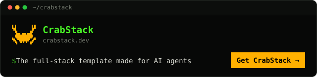

  Sponsored by 
  

<h1>Remote Junior Developer jobs directory</h1>

<h3>The whole point of this repo is to list information about getting a remote job as a junior developer</h3>

<h2>Checklist</h2>
Things you can do to increase your chance of success. Making an effort on these shows that you are serious in your job search, and that you respect the other party looking to hire a new developer.

| ToDo                                                       | Why?                                                                                                                                                                                                                                                                                                                                                                                                                        |
| ---------------------------------------------------------- | --------------------------------------------------------------------------------------------------------------------------------------------------------------------------------------------------------------------------------------------------------------------------------------------------------------------------------------------------------------------------------------------------------------------------- |
| GitHub                                                     | Those green squares matter, and show consistent code pushing for long periods. Pick projects with intent. If you want to land a frontend web development position, then pick projects related to that with increasing difficulty                                                                                                                                                                                            |
| Contribute to Open-Source                                  | This might sound daunting for anyone to get into but it truly makes all the difference. It does not matter how small of a contribution you are making, correct some docs, fix grammar problems. You can make repositories where you collect resources (like this one), learnings, developer logs, etc. These things are the fundamentals that you can build upon right when you start.                                      |
| Personal Site                                              | Make sure that your personal site looks alright, all links working, no typos, easy structure for visitors to find the information they are looking for. All projects linked should have a GitHub link for the source code and hosted version.                                                                                                                                                                               |
| Start blogging                                             | Writing about your daily progress is a win-win situation. You help others struggling with the same thing, you help yourself understand it better, and you take steps towards building your developer brand. A potential hiring party can go in and see your progress and they can see how you communicate ideas or code to others, further they can see a glimpse of who you are and build a perception of you as a person. |
| Stable internet                                            | It sounds like a no-brainer but when working remotely it becomes very clear if your connection is not great. Would you hire someone to work for you remotely if they keep disconnecting? probably not right?                                                                                                                                                                                                                |
| Comfortable to Share screen                                | As a remote developer, you'll be sharing your screen a lot. Our computers are very private, and normally no one sees the things you keep there. Keep an SFW version of it, in case you need to share it unexpectedly.                                                                                                                                                                                                       |
| Clear communication                                        | The ability to explain code clearly and concisely and talk about complex topics. Code is sometimes difficult to explain because we are not used to talking while we code and our mind-maps of how things fit together will be unique to you. However, no one will hire you if you can not explain what you are doing.                                                                                                       |
| Be in the now                                              | Be alert, be present, and answer questions within a reasonable amount of time on Slack or Email. And turn everything off during your interview.                                                                                                                                                                                                                                                                             |
| Calm environment                                           | If you have constant background noise, like motorcycles, trucks, vacuum cleaners, and screaming, (you get the point), You will not be liked in your everyday meetings. Dare I say low-key hated? So, find a quiet spot to work.                                                                                                                                                                                             |
| Voice Quality                                              | This ties into the above row, but if your microphone is bad, buy a new one. Record yourself, listen to it and you'll understand what the other side is hearing.                                                                                                                                                                                                                                                             |
| Energy                                                     | You want to send a lot of positive energy to the person you are talking to. You have to be interested in what you do and like to talk about things related to the field. Don't be a bigot, asshole, racist, or show other negative characteristics. At least pretend...                                                                                                                                                     |
| Know what you know and that you want to continue learning. | If there's something you don't know, come clean and say that you have not used that technology yet. It shows that you know what you don't know, and explain that you are willing to learn that asap if that's a required skill. Maybe fire up a new repo and do something with it, and send it soon after the meeting ended. It shows you are a self-starter and can learn new things when required.                        |

<h2>Remote Jobs Directories</h2>
<ul>
  <li>Meridian: https://meridianremote.com/ (remote tech jobs matched to your timezone for US, LATAM, and EU; aggregated and deduplicated from top boards and ATS feeds)</li>
  <li>WeWorkRemotely: https://weworkremotely.com/</li>
  <li>RemoteYeah: https://remoteyeah.com/</li>
  <li>Remotive: https://remotive.com/</li>
  <li>RemoteOK: https://remoteok.com/</li>
  <li>Himalayas: https://himalayas.app</li>
  <li>Hubstaff Talent Jobs: https://hubstafftalent.net/</li>
  <li>Authentic Jobs: https://authenticjobs.com/</li>
  <li>Just UX Jobs: https://justuxjobs.com/</li>
  <li>Jobspresso: https://jobspresso.co/</li>
  <li>Reactiflux Jobs: https://reactiflux.com/jobs</li>
  <li>Wellfound (formerly AngelList Talent): https://wellfound.com/</li>
  <li>Findwork.dev: https://findwork.dev/junior-jobs?remote=true</li>
  <li>Remote Leads: https://remoteleads.io/</li>
  <li>Working Nomads: https://www.workingnomads.com/jobs</li>
  <li>4 day week: https://4dayweek.io/</li>
  <li>Findjobit: https://findjobit.com/jobs</li>
  <li>Agentic Engineering Jobs: https://agentic-engineering-jobs.com (job board for engineers building agentic systems — RAG, AI agents, LLM-powered products, agent orchestration)</li>
  <li>FoundRole: https://www.foundrole.com (free AI job search with a Kanban tracker and career tools)</li>
  <li>Jobs in JS: https://jobsinjs.com/remote-javascript-jobs/ (remote JavaScript jobs)</li>
  <li>HeyRole: https://heyrole.ai/ (remote jobs with location and role filters, an AI job-search assistant, and original posting links)</li>
</ul>

<h2>Placement consultancies</h2>

Placement consultancies match developers with software projects in other companies. They do the heavy lifting of interviewing, and validating the engineers and match them according their respective skills. Some of these might be difficult to get into as a junior, but it's not impossible if you can show real projects in your portfolio and perform strong on the tests they present.

<ul>
  <li>Lemon: https://lemon.io/</li>
  <li>A-Team: https://a.team/</li>
  <li>Inclusion Cloud: https://inclusioncloud.com/</li>
  <li>X-Team: https://x-team.com/</li>
  <li>Toptal: https://toptal.com/</li>
</ul>

<h2>Freelancing</h2>

Freelancing is a Great way to get real experience, it's not easy to earn a living through these sites but one might get some projects under the belt to put on the portfolio

<ul>
  <li>Upwork: https://upwork.com</li>
  <li>Guru: https://guru.com</li>
  <li>Freelancer: https://freelancer.com</li>
  <li>Fiverr: https://fiverr.com</li>
  <li>Workana: https://workana.com</li>
</ul>

<h2>Great helpful & Friendly Communities</h2>

<strong>Discord Servers</strong>

<ul>
  <li>Reactiflux: https://discord.com/invite/reactiflux</li>
  <li>FreeCodeCamp (un-official): https://discord.com/invite/nKKgCbA</li>
</ul>

<strong>Slack Channels</strong>

<ul>
  <li>Remotive (paid membership): <a href="https://remotive.com/join">Link</a></li>
</ul>

<h2>Job Search Newsletters/Twitter Accounts</h2>

<ul>
  <li>The Memo: Newsletter with remote jobs, with a focus primarily on early-stage startups. The newsletter is free, but paying subscribers get early-access, discounts and more from partners. 
     Sign up here: <a href="https://thememo.substack.com">https://thememo.substack.com</a>
     Twitter: <a href="https://twitter.com/TheMemo____">@TheMemo____</a>
  </li>
  <li>Epic Jobs: Discover jobs for design, product, ux, ui, engineering, pm, research, and more via Twitter + video. 
     Website: <a href="https://epicjobs.co/">https://epicjobs.co/</a>
     Twitter Account: <a href="https://twitter.com/epicjobs">@epicjobs</a>
  </li>
</ul>

<h2>Great Resources</h2>

<strong>Youtubers/Youtube Channels</strong>

<ul>
  <li>Traversy Media: 
  <a href="https://youtube.com/user/TechGuyWeb">Channel Link</a></li>
  <li>Coding Addict:
  <a href="https://youtube.com/channel/UCMZFwxv5l-XtKi693qMJptA">Channel Link</a></li>
  <li>Dev Ed:
  <a href="https://youtube.com/channel/UClb90NQQcskPUGDIXsQEz5Q">Channel Link</a></li>
  <li>FreeCodeCamp Official Channel:
  <a href="https://youtube.com/channel/UC8butISFwT-Wl7EV0hUK0BQ">Channel Link</a></li>
  <li>Eddie Jaoude:
  <a href="https://youtube.com/user/eddiejaoude">Channel Link</a></li>
  <li>Fireship:
  <a href="https://youtube.com/channel/UCsBjURrPoezykLs9EqgamOA">Channel Link</a></li>
  <li>Brice Ayres:
  <a href="https://youtube.com/channel/UC9nBRXEi-gthsZf8BBhp_Jw">Channel Link</a></li>
  <li>Chris Hawkes:
  <a href="https://youtube.com/user/noobtoprofessional">Channel Link</a></li>
  <li>Andrew Cunliffe:
  <a href="https://youtube.com/channel/UC4hff1Dpvf4zMsQwLmt0LIQ">Channel Link</a></li>
  <li>LevelUpTuts:
  <a href="https://youtube.com/user/LevelUpTuts">Channel Link</a></li>
  <li>TheCodePro:
  <a href="https://youtube.com/channel/UC8QVCQsp1YCgTI--nACeZsw">Channel Link</a></li>
  <li>Hamza Mirza:
  <a href="https://youtube.com/channel/UCBV-JvG9Ubkj7AU6Cxls1Tw">Channel Link</a></li>
  <li>Rem Zolotykh:
  <a href="https://youtube.com/user/MrRemchi">Channel Link</a></li>
  <li>Academind:
  <a href="https://youtube.com/channel/UCSJbGtTlrDami-tDGPUV9-w">Channel Link</a></li>
  <li>Meth Meth Method:
  <a href="https://youtube.com/channel/UC8A0M0eDttdB11MHxX58vXQ">Channel Link</a></li>
  <li>Programming with Mosh:
  <a href="https://youtube.com/user/programmingwithmosh">Channel Link</a></li>
  <li>Ben Awad:
  <a href="https://youtube.com/user/99baddawg">Channel Link</a></li>
  <li>JustDjango:
  <a href="https://youtube.com/channel/UCRM1gWNTDx0SHIqUJygD-kQ">Channel Link</a></li>
  <li>Code Artistry:
  <a href="https://youtube.com/channel/UC-kHm7pG884IYQiYwqJWv9A">Channel Link</a></li>
  <li>interviewing.io:
  <a href="https://youtube.com/channel/UCNc-Wa_ZNBAGzFkYbAHw9eg">Channel Link</a></li>
  <li>Awesome Tuts:
  <a href="https://youtube.com/channel/UC5c-DuzPdH9iaWYdI0v0uzw">Channel Link</a></li>
  <li>80/20 Coding:
  <a href="https://youtube.com/channel/UCobZg0ym72ZZPqOQNB_qJnw">Channel Link</a></li>
  <li>CodingEntrepreneurs:
  <a href="https://youtube.com/user/CodingEntrepreneurs">Channel Link</a></li>
  <li>Andy Sterkowitz:
  <a href="https://youtube.com/channel/UCZ9qFEC82qM6Pk-54Q4TVWA">Channel Link</a></li>
  <li>Code Realm:
  <a href="https://youtube.com/channel/UCUDLFXXKG6zSA1d746rbzLQ">Channel Link</a></li>
  <li>Rayn Studios:
  <a href="https://youtube.com/channel/UCUmQhjjF9bsIaVDJUHSIIKw">Channel Link</a></li>
  <li>Daft Creation:
  <a href="https://youtube.com/channel/UCDrfHGsm6bJI7Sli7vlcteA">Channel Link</a></li>
  <li>The Coding Train:
  <a href="https://youtube.com/user/shiffman">Channel Link</a></li>
  <li>Coding Tech:
  <a href="https://youtube.com/channel/UCtxCXg-UvSnTKPOzLH4wJaQ">Channel Link</a></li>
  <li>Sourav Johar:
  <a href="https://youtube.com/user/RSOURAV100">Channel Link</a></li>
</ul>

<h4>Companies with remote DNA</h4> 

<ul>
  <li>Chili Piper: 100% fully remote team, with good benefits.  https://chilipiper.com/careers/</li>
<li>Valohai: Machine Learning version control in the cloud:  https://valohai.com/careers/</li>
<li>10up - 10up makes the web better by finely crafting websites & tools for content creators.  https://10up.com/careers/</li>
<li>AgentFire - Hyper local real estate websites powered by Wordpress.  https://agentfire.com/meet-our-team/</li>
<li>Aha! - Aha! is roadmapping software for PMs who want their mojo back.  https://aha.io/company/careers/current-openings</li>
<li>AirTreks - Multi-stop international flight planner with a distributed team. https://airtreks.com/about/</li>
<li>Alley - Digital Agency. We are strategists, researchers, designers, and developers who craft custom digital experiences for publishers, nonprofit institutions, museums, and brands.  https://alley.com/careers/</li>
<li>Arkency - Rails and React.js experts, fully remote/async.  https://blog.arkency.com/join-our-team/</li>
<li>Articulate - EdTech. Makes software that helps teachers make e-learning courses. Ruby, Node, C#, and .NET for Windows app.  https://www.articulate.com/</li>
<li>AT&T - Nearly 20% of the eligible workforce works remotely.  https://att.jobs/</li>
<li>Auth0 - Zero-friction authentication and authorization for developers.  https://auth0.com/jobs</li>
<li>Authentic F & F - Independent design and technology studio based in Denver and Minnesota.  https://authenticff.com/</li>
<li>Aurity - 100% remote company, specializing in React and React Native.  https://aurity.co/</li>
<li>Automattic - Makers of WordPress.com and Gravatar.  https://automattic.com/work-with-us/</li>
<li>Avallain - Education Technology and Digital Publishing. We have the tools and processes to achieve the positive impact on human potential that technology enhanced education can provide.  https://avallain.com/</li>
<li>AvantStay - Short-term rental company based in Los Angeles, with remote dev team.  https://avantstay.com/careers</li>
<li>Axelerant.  https://axelerant.com/careers</li>
<li>Baremetrics - Analytics and insights for Stripe, Braintree, Recurly and Chargify.  https://baremetrics.com/about</li>
<li>BaseCamp - Project management software.  https://basecamp.com/about/team</li>
<li>Baselayer - Data center and infrastructure management software.  https://baselayer.com/</li>
<li>BeBanjo - Software as a service for managing video on-demand. Ruby / Rails, Elasticsearch, Sidekiq.  https://bebanjo.com/careers/</li>
<li>Bluespark Labs - WebDev Consulting and makers of Roomify. Remote team with HQs in Raleigh, NC and Italy. Drupal.  https://bluespark.com/work-at-bluespark</li>
<li>Smily (formerly BookingSync) - Vacation Rental Software for professionals. Fully distributed team, we work remotely and try to make a company retreat each year. Proud Ember.js official sponsor, Ruby / Rails.  https://www.smily.com/company/jobs</li>
<li>Brave - Web browser with built-in ad blocker and crypto-token micro-payments.  https://brave.com/</li>
<li>Buffer - Tools to help manage social media. PHP, CodeIgniter, MongoDB, Memcache, Backbone.js, React.js, Grunt.js, LESS, and Python.  https://buffer.com/journey/</li>
<li>Bugfender - Bugfender is a remote logger for multiple platforms including iOS and Android. It stores logs created by your application and sends them to our server, creating a remote console where you can see logs in real time. Remote company based in Barcelona.  https://bugfender.com/</li>
<li>ButterCloud - A small team of web & app developers. We help startups & small to medium sized businesses build, maintain, and grow their products.  https://buttercloud.com/</li>
<li>Cadasta - Secure platform for mapping global land & resource rights. 100% remote team; Python, Django, JavaScript, PostgreSQL.  https://cadasta.org/about-us/careers/</li>
<li>Canonical - Ubuntu.  https://canonical.com/careers/all-vacancies</li>
<li>Chef - We are all about IT automation for speed and awesomeness. Ruby, JavaScript & shell scripting. HQ in Seattle but we have employees all around US.  https://chef.io/careers/</li>
<li>Ciao Bambino - Family destinations and hotel reviews.  https://ciaobambino.com/</li>
<li>CircleCI - Provides continuous integration tools and services.  https://circleci.com/jobs#engineer</li>
<li>Circonus - SaaS and on-prem monitoring, analytics, alerting, and more. C, Go, Java, Perl. HQ in Fulton MD, most employees are remote.  https://circonus.com/careers</li>
<li>Lumenalta (formerly Clevertech) - We build incredible, game changing technology.  https://lumenalta.com/remote-jobs</li>
<li>Close - Inside sales CRM for startups and SMBs.  https://close.com/</li>
<li>Codeship - SaaS Continuous Delivery.  https://codeship.com/jobs</li>
<li>Collabora - Open source software-based consulting.  https://collabora.com/careers.html</li>
<li>ConsenSys - Blockchain software technology company with offices all around the world, and independent employees in even more locations.  https://consensys.com/careers</li>
<li>Countly - Open source, enterprise mobile / web analytics and marketing platform.  https://countly.com/jobs</li>
<li>CRO Metrics - Data-driven expirementation and growth programs.  https://crometrics.com/jobs/</li>
<li>Crossover - Project-based Java, .Net and DevOps positions.  https://app.crossover.com/x/marketplace/available-jobs</li>
<li>Datadog - Easy to use and scalable monitoring systems for modern and dynamic infrastructure. Distributed team with offices in New York, Boston and Paris. Engineers based all around the world.  https://datadoghq.com/careers/</li>
<li>DataStax - Consulting based on Apache Cassandra.  https://datastax.com/company/careers</li>
<li>Deeson - UK-based with European team. Digital agency specialising in Drupal, Symfony and Laravel.  https://deeson.co.uk/careers</li>
<li>Demio - Webinar platform that just works.  https://www.demio.com/</li>
<li>digitalminds.io - Freelance platform, open for Developers, IT-consultants and Digital Experts.  https://digitalminds.io/</li>
<li>DigitalOcean - Simple Cloud Hosting, Built for Developers.  https://digitalocean.com/careers/</li>
<li>Discourse - Civilized discussion for your community.  https://discourse.org/team</li>
<li>DNSimple - Small 100% remote and globally distributed team working to make domain management an afterthought.  https://dnsimple.com/</li>
<li>Doist - Redefining productivity since 2007.  https://doist.com/jobs/</li>
<li>Dotsub - Browser-based platform for subtitling & translating online videos. Java / Spring, JavaScript / React.js.  https://dotsub.com/jobs</li>
<li>Doximity - Largest online medical network of US physicians. Ruby, Rails, Go, JavaScript, MySQL.  https://doximity.com/about/jobs</li>
<li>Drupal Association - Non-profit supporting the Drupal project.  https://assoc.drupal.org/jobs</li>
<li>DuckDuckGo - Search engine.  https://duck.co/help/company/hiring</li>
<li>EasyCommunicationTechnology - .NET development using C#, Angular, Azure. Remote-first company.  https://easycomtec.com/homeoffice/developer</li>
<li>Elastic - Open source search & analytics.  https://elastic.co/</li>
<li>Envato - Maker of ThemeForest and other online marketplaces. MySQL, Ruby, Rails, Javascript. Distributed team with HQ in Melbourne, Australia.  https://envato.com/careers</li>
<li>Etsy - Marketplace for artists. MySQL, Memcache, PHP. Offices in Dublin, Paris, San Francisco, New York, London and Melbourne.  https://etsy.com/careers</li>
<li>Eyeo - Maker of AdBlock Plus. Main office in Cologne, Germany.  https://eyeo.com/careers/</li>
<li>Findify - E-commerce search powered by machine learning and big data. Team distributed across Europe.  https://findify.io/</li>
<li>General Assembly - Physical and on-line education for technology, business, and design.  https://generalassemb.ly/careers</li>
<li>Ghost - Publishing platform.  https://ghost.org/about/#careers</li>
<li>Gigster - vetted network of top 5% freelancers worldwide. PM, Dev, Sales positions available.  https://gigster.com/</li>
<li>Gitbook - Publishing toolchain based on git. Javascript, node.js, Go.  https://www.gitbook.com/careers</li>
<li>GitHub. https://github.com/about/jobs</li>
<li>GitLab - Competitor to GitHub.  https://about.gitlab.com/jobs/</li>
<li>Gradle - Open Source Build Tool ; Enterprise SaaS and on-premise. Fully remote. Java, Groovy, Kotlin.  https://gradle.com/careers</li>
<li>GrooveHQ - Help desk software.  https://groovehq.com/about</li>
<li>Hanzo - Web archiving company. Fully Remote. Python, AWS.  https://hanzo.co/careers</li>
<li>Harvest - Time tracking software.  https://getharvest.com/careers</li>
<li>HashiCorp - Open source tools for automating the modern data center. Go, Ruby, Rails, Ember, JavaScript.  https://hashicorp.com/jobs.html</li>
<li>Heap – Web & Mobile Analytics.  https://www.heap.io/careers/jobs</li>
<li>Help Scout - A help desk for teams that insist on a delightful customer experience.  https://www.helpscout.com/company/careers/</li>
<li>Heroku - PaaS Cloud, makes devs' experience awesome, Ruby, Erlang, Javascript, Golang, Python.  https://heroku.com/careers</li>
<li>Honeybadger - Ruby. 100% remote.  https://honeybadger.io/</li>
<li>Hotjar - Analytics & Feedback tool.  https://careers.hotjar.com/</li>
<li>Hubstaff - Time tracking solution with multiple integrations.  https://hubstaff.com/jobs</li>
<li>Igalia - Open source consultancy. HQ in Spain.  https://igalia.com/jobs/</li>
<li>Incsub - Remote team that builds Wordpress projects.  https://incsub.com/careers/</li>
<li>Syde (formerly Inpsyde) - WordPress Agency in Germany.  https://syde.com/</li>
<li>Institute for Nonprofit News - Nonprofit news organization.  https://inn.org/about/jobs/</li>
<li>Instructure - We make software that makes people smarter.  https://instructure.com/careers/</li>
<li>Intellum - We build employee collaboration, performance and learning tools. Ruby, iOS, Android, AWS, GCS.  https://intellum.com/</li>
<li>InVision - prototyping, collaboration & workflow platform.  https://invisionapp.com/company#jobs</li>
<li>Isos Technology - premier Atlassian Platinum & Enterprise Solution Partner, helping organizations solve complex development and business problems with the Atlassian tools.  https://careers.isostech.com/</li>
<li>Jackson River - Digital-first technology and strategy for nonprofits.  https://jacksonriver.com/about/jobs</li>
<li>Judge.me - A review platform for ecommerces. Our company is fully remote across 4 continents.  https://judge.me/</li>
<li>Keepsafe - Mobile-first privacy products, making privacy easy for the world to opt into.  https://getkeepsafe.com/</li>
<li>Khan Academy - EdTech. Non-profit focusing on K-12 STEM. Less, React, Flux, Backbone, jQuery, Python, Google App Engine, Swift, and Objective-C.  https://khanacademy.org/careers</li>
<li>Knack - The easy online database.  https://knack.com/jobs</li>
<li>LaterPay - The (micro)payment enabler. Munich, Germany. Python, JavaScript, AWS.  https://laterpay.net/</li>
<li>LaunchPotato - Startup studio based in Delray Beach, Florida.  https://launchpotato.com/careers</li>
<li>Librato - Cloud Monitoring.  https://solarwinds.jobs/solarwinds-cloud/</li>
<li>Linaro - OpenSource Engineering on ARM.  https://linaro.org/careers/</li>
<li>Lincoln Loop - WebDev shop.  https://lincolnloop.com/</li>
<li>Litmus - Optimization tools for email professionals. Offices in Boston and London, but nearly 50% of the team works remotely.  https://www.litmus.com/</li>
<li>LivingSocial - Company-wide support for teams of experienced, remote developers. Lots of autonomy.  https://jobs.groupon.com/</li>
<li>Lullabot - Strategy, design and development using Drupal.  https://lullabot.com/jobs</li>
<li>madewithlove - We help companies build digital products and bring new juice to teams that seem to jam.  https://madewithlove.com/about/careers/</li>
<li>MariaDB - Open source database.  https://mariadb.com/about-us/careers</li>
<li>MarsBased - MarsBased is a development consultancy from Barcelona offering end‑to‑end web & mobile apps based on Ruby on Rails, Angular and other Javascript frameworks.  https://marsbased.com/</li>
<li>Mapbox - Map integration tools for various platforms.  https://mapbox.com/jobs/</li>
<li>MeetEdgar - Automated social sharing. US remote.  https://meetedgar.com/careers/</li>
<li>Modern Tribe - A digital agency with a modern twist. All freelancers. All experts.  https://tri.be/about/join-our-team/</li>
<li>Modus Create - Modus is a digital design-build agency driven by world-class talent. PHP, Javascript.  https://moduscreate.com/</li>
<li>Mosalingua - Learn words, enjoy the world.  https://mosalingua.com/en/jobs/</li>
<li>MVP Space - Test a business idea with your target audience or show its potential to your investors.  https://mvp-space.com/</li>
<li>Mozilla - Firefox has a 'Remote' option under it's location searchbar.  https://careers.mozilla.org/listings/</li>
<li>NearForm - NearForm evolves enterprises by building high-performance, open software. Our global team uses modern processes and tools to help clients innovate at speed.  https://nearform.com/careers/</li>
<li>Nectafy - Inbound marketing and content creation.  https://nectafy.com/jobs/</li>
<li>Invicti (formerly Netsparker) - Web Application Security Scanner.  https://www.invicti.com/careers</li>
<li>NinjaCat - Reporting, Monitoring & Call Tracking Platform for Leading Digital Agencies.  https://ninjacat.io/jobs</li>
<li>Niteo - A decade old SaaS studio full of bright ideas, building smart solutions to empower small businesses online.  https://niteo.co/careers</li>
<li>NodeSource - NodeSource is dedicated to creating a sustainable ecosystem for Node.js.  https://nodesource.com/about</li>
<li>ofri - A swiss online marketplace that connects homeowners with quality home improvement professionals.  https://www.ofri.ch/jobs</li>
<li>Olark - Chat support funnel.  https://olark.com/jobs</li>
<li>onTheGo Systems - WordPress Developer, Supporter and Marketing Jobs.  https://onthegosystems.com/jobs/</li>
<li>Onyo - Transforming the eating out experience in pure pleasure.  https://onyo.com/</li>
<li>OpenCraft - Open edX development (Free Software MOOC project).  https://opencraft.com/</li>
<li>Owsy - International studio focused on creating products for financial service firms.  https://owsy.com/careers/</li>
<li>Parknav - Intelligent parking using AI.  https://parknav.com/</li>
<li>Parsely - Analytics solutions.  https://www.parse.ly/careers/</li>
<li>Particular Software (NServiceBus) - Enterprise Service Bus, Messaging, C#, Open Source.  https://particular.net/careers</li>
<li>Patients Know Best - Empowering patients to manage their care, enabling professionals to share information while improving efficiencies for payers.  https://patients.workable.com/</li>
<li>Paylocity - HR and payroll solutions.  https://paylocity.com/careers/</li>
<li>Pilot - Pilot is a software platform that removes all the pain from contract work. We find work, negotiate contracts, send invoices and chase payments for hundreds of forward-looking engineers and designers around the world.  https://pilot.co/</li>
<li>Pleo - Pleo is a company payment card solution that automates expense reports and simplifies company spending.  https://www.pleo.io/en/careers</li>
<li>Precision Nutrition - Online Nutrition Coaching and Certification.  https://precisionnutrition.com/</li>
<li>PreviousNext - Australian based Drupal agency.  https://previousnext.com.au/</li>
<li>Prezly - SaaS PR platform. PHP, React, JS, Postgres. 100% remote.  https://prezly.com/</li>
<li>RainforestQA - On demand QA as a service.  https://www.rainforestqa.com/careers</li>
<li>Real HQ - Maker of Agent Pronto, software designed to help make home buying and selling a better experience. We've been remote since the start, now 50+ spread across the globe. Ruby, Rails, React.js, iOS/Android.  https://realhq.com/</li>
<li>RebelMouse - Social publishing platform. Python, JS & iOS/Android developers. All over the world team.  https://blog.rebelmouse.com/careers/</li>
<li>Recurly - recurring billing management for subscription-based businesses.  https://recurly.com/jobs/</li>
<li>Red Hat.  https://jobs.redhat.com/</li>
<li>RightScale.  https://rightscale.com/jobs</li>
<li>Sangoma - Trusted leader in delivering globally scalable Voice-Over-IP telephony systems, both on-site and cloud-based. C, PHP, Python, JavaScript, Linux, FreePBX, VoIP.  https://sangoma.com/</li>
<li>Zyte (formerly Scrapinghub).  https://www.zyte.com/jobs/</li>
<li>ServiceNow - Enterprise cloud computing to improve service levels, energize employees, and change the way your enterprise works. Work at lightspeed.  https://jobs.jobvite.com/servicenow/search?c=&l=&r=&t=&q=remote</li>
<li>ShakaCode - A global web development software consultancy and product company.  https://shakacode.com/about/index.html#work-with-us</li>
<li>Shogun - Build and optimize eCommerce landing pages. Ruby / Rails, Go, JavaScript, React. 100% remote.  https://getshogun.com/team</li>
<li>Signal - These people make the fantastic Signal app. US Only.  https://signal.org/workworkwork/</li>
<li>Skyscrapers - Cloud hosting services & management. Working with multiple cloud providers (AWS, Digital Ocean, Linode, ...). 100% remote.  https://skyscrapers.eu/jobs/</li>
<li>SoftwareMill.  https://softwaremill.com/join-us/</li>
<li>Soshace - Angular/React/Vue.js/Java/Python remote development company.  https://soshace.com/</li>
<li>Songspace Helps music creators collaborate, catalog, and share work with their professional team.  https://songspace.com/</li>
<li>Soostone.  https://www.soostone.com/</li>
<li>Spreaker Discover and listen to your favorite podcasts.  https://www.spreaker.com/</li>
<li>Stack Overflow.  https://stackoverflow.co/company/careers</li>
<li>Student Loan Hero - 100% remote company on a mission to help 44 million Americans manage and repay over $1.4 trillion in student loan.  https://studentloanhero.com/careers/</li>
<li>StyleSeat - we love high-impact remote engineers, collaboration, creativity, python, angularjs.  https://static.styleseat.com/jobs/index.html</li>
<li>Surevine.  https://surevine.com/jobs/</li>
<li>Sysdig Cloud.  https://sysdig.com/jobs/</li>
<li>Taskade - Remote team building real-time collaboration & collaborative editing for teams.  https://taskade.com/contact/</li>
<li>TaxJar - Eliminate sales tax headaches.  https://taxjar.com/jobs/</li>
<li>Teamed.io.  https://www.teamed.io/</li>
<li>TeamSnap - TeamSnap is the No. 1 online sports team management software. 80% remote employees.  https://teamsnap.com/about/careers</li>
<li>TED - Technology team supports ted.com and internal tools. All engineers are remote. Ruby on Rails, JavaScript, Ember.js.  https://ted.com/about/our-organization/jobs-at-ted</li>
<li>Teleport.  https://teleport.org/jobs/</li>
<li>Tesera - We disrupt conventional thinking to expand what is possible. We ignite change in the future we share.  https://tesera.com/</li>
<li>The Grid - AI website builder. 100% distributed team.  https://thegrid.io/</li>
<li>Thermeon - Car rental software - 100% remote technical team.  https://thermeon.com/</li>
<li>TimeDoctor - Time tracking with screenshots, web and app usage monitoring, and integrations.  https://www.timedoctor.com/careers</li>
<li>Tipe - Next Generation API-first CMS with GraphQL or REST API. Built with Nuxt.js, Serverless, AWS. 25% remote.  https://tipe.io/</li>
<li>Toggl.  https://jobs.toggl.com/</li>
<li>Toptal - 100% remote development company, solving worldwide talent shortage.  https://toptal.com/careers</li>
<li>Tortuga Backpacks - Backpacks for city travel.  https://tortugabackpacks.com/pages/join</li>
<li>Transloadit - The world's most versatile file uploading & encoding service, since 2009, by devs for devs.  https://transloadit.com/jobs/</li>
<li>Trello.  https://trello.com/jobs</li>
<li>Twin Technologies.  https://twintechs.com/about-twin/careers</li>
<li>Vidalingua - Bringing language apps to life.  https://vidalingua.com/amaze.php</li>
<li>WAAT - A cross-functional digital agency that adapts to project needs.  https://waat.eu/</li>
<li>Water Lily Pond - Advertising and marketing communication services.  https://waterlilypond.co.uk/</li>
<li>wemake.services - We sell repeatable software development process. Fully remote. Python, Javascript, Vue.  https://wemake.services/meta/employees</li>
<li>Wikimedia.  https://wikimediafoundation.org/wiki/Work_with_us</li>
<li>You Need a Budget - Bank syncing and goals and debt management.  https://www.ynab.com/careers</li>
<li>Zamphyr - School 2.0 for learning computer science. Remote-first, 100% JavaScript mostly Meteor.  https://zamphyr.com/</li>
<li>Zapier.  https://zapier.com/about/</li>
<li>ZipRecruiter - Perl/Catalyst shop that has some of the best Perl devs working remotely.  https://ziprecruiter.com/careers</li>
</ul>
